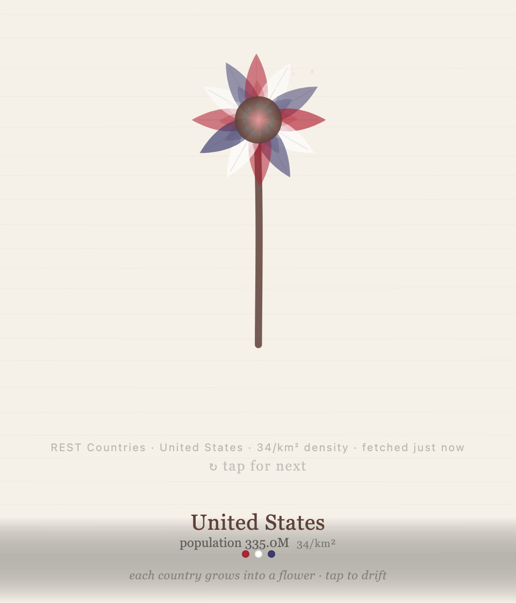
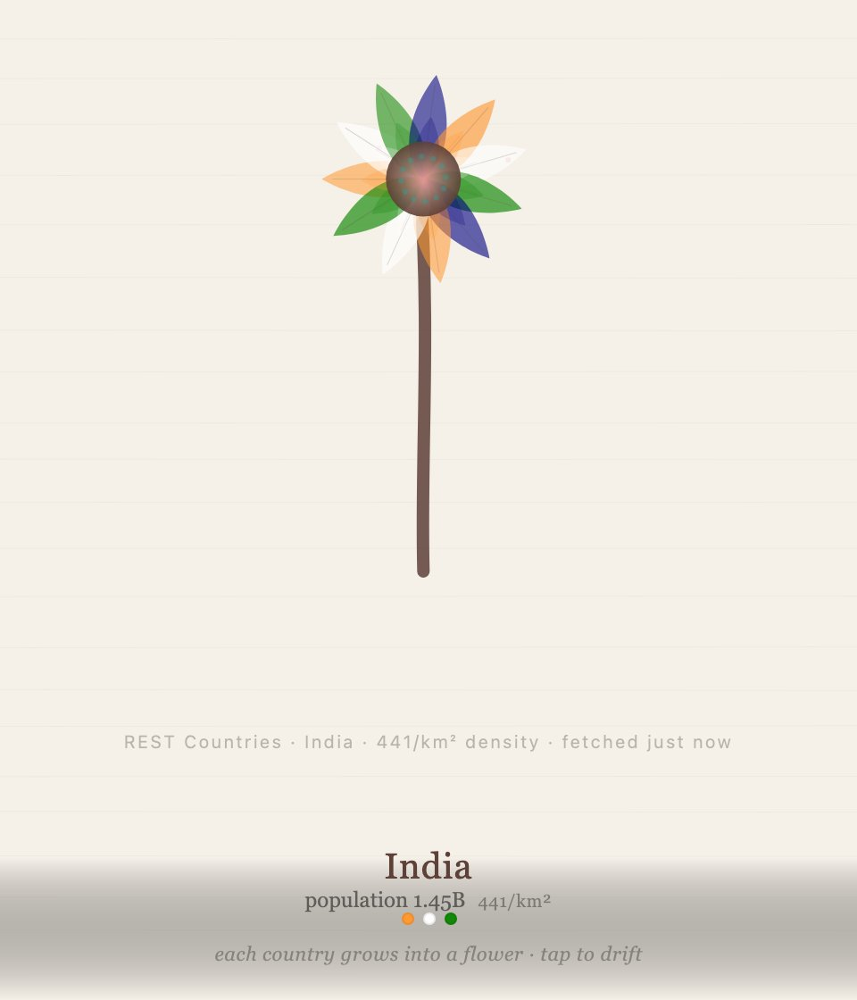
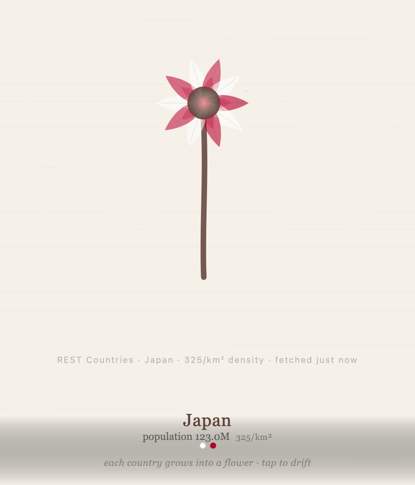

<div align="center">

<h1>flora</h1>

<p><b>Each country grows into a flower.</b></p>

<p><i>Population sets the stem, land area sets the petals, and the flag colours the bloom.</i></p>

<h6>


</h6>

<a href="https://parthchandak02.github.io/flora/"><b>Live demo</b></a> ·
<a href="#how-it-works"><b>How it works</b></a> ·
<a href="#run-it"><b>Run it</b></a>

<br><br>

<a href="https://parthchandak02.github.io/flora/"></a>&nbsp;<a href="https://parthchandak02.github.io/flora/"></a>&nbsp;<a href="https://parthchandak02.github.io/flora/"></a>

<sub>Live site, 22 October 2026: the first, second and fifth flowers. Figures come from the page's built-in country table (see below).</sub>

</div>

<br>

flora draws one country at a time as a flower on cream paper. It grows from the ground up over
two and a half seconds, then sways gently; tap or click to let it fade and grow the next one.
The cycle runs through 15 countries: the United States, India, China, Brazil, Japan, France,
the United Kingdom, Australia, Egypt, Mexico, Russia, South Korea, Nigeria, Germany and Italy.

## How it works

| Country data | Drives |
|---|---|
| Population (log scale) | Stem height and thickness |
| Land area (log scale) | Number of petals, 5 to 12, and the size of the bloom |
| Flag colours | Petal colours, cycled around the flower, plus the dots under the name |
| Population ÷ area | The density figure in the caption and the data line |

The page tries the REST Countries `v3.1/all` endpoint first and falls back to a built-in table
of rounded populations and areas when that fails. REST Countries has since retired v3.1, so
today the live site always draws from the built-in table, even though the data line still
credits REST Countries. Flag colours always come from a hand-written map in the code.

## Run it

```bash
git clone https://github.com/parthchandak02/flora.git
cd flora
python3 -m http.server 8000   # then open http://localhost:8000
```

Or open `index.html` directly. Everything (config, fallback data, flag colours, drawing) is
in that one file. The live version is served by GitHub Pages from the default branch.

Part of the [daily generative builds](https://github.com/parthchandak02/parthchandak02#featured-projects)
series: [tessellate](https://parthchandak02.github.io/tessellate/) ·
[grow](https://parthchandak02.github.io/grow/) · [drift](https://parthchandak02.github.io/drift/) ·
[trace](https://parthchandak02.github.io/trace/) · [resonate](https://parthchandak02.github.io/resonate/) ·
[swell](https://parthchandak02.github.io/swell/) · [flux](https://parthchandak02.github.io/flux/)

<br>

<div align="center">
<sub>Built with plain Canvas 2D in one HTML file.</sub>
</div>
